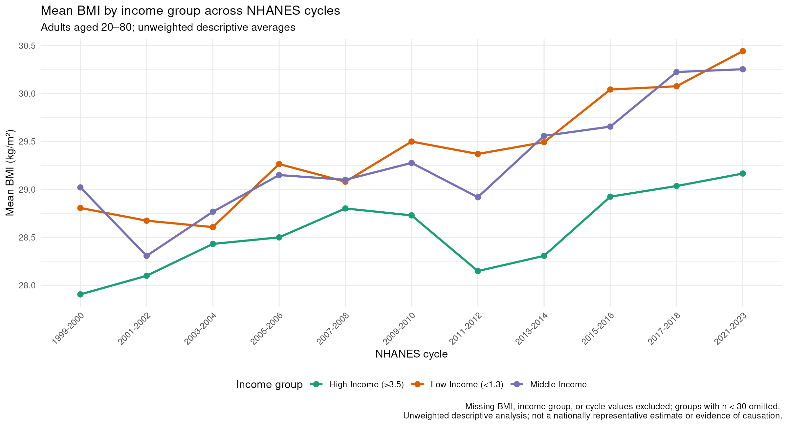

## Question and Audience

**Audience:** Public health analysts reviewing BMI patterns across income groups.

**Question:** How does average BMI differ across income groups and NHANES survey periods?

**Why it matters:** Looking at these differences can help identify patterns that may be worth exploring further.

## BMI Patterns Across Income Groups

{width="90%"}

<small>Source: Prepared NHANES Health Equity classroom dataset, derived from CDC/NCHS NHANES public-use data.</small>

## Main Takeaway

Average BMI was not the same across income groups, and the differences varied between NHANES survey periods.

These patterns are worth looking into further, but the graph alone cannot explain why they occurred.

## Limitations of the Analysis

The graph shows differences in average BMI, but it does not explain what is behind those differences.

Other factors may contribute to these patterns, including differences in access to healthcare, lifestyle, and living conditions. These factors were not examined in this analysis.

The results are descriptive and unweighted, so they cannot be generalized to the US population or used to establish a causal relationship between income and BMI.

## Implications and Next Steps

The differences in average BMI across income groups raise questions about the factors that may contribute to these patterns.

Further research could explore how access to healthcare, living conditions, and other social factors relate to BMI.

Using survey weights and considering additional variables would also help provide a more complete understanding of these differences.

*AI-use disclosure: AI was used to help organize the slides and revise the wording. The findings and limitations were checked against the corrected Assignment 5 visualization and its caption.*
